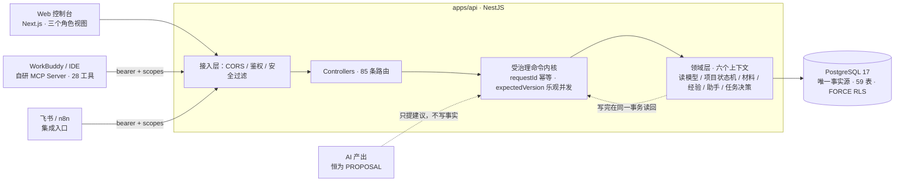

# 鼎江智绩 2.0

[](https://github.com/lqyq666/dingjiang-zhiji-2/actions/workflows/ci.yml)
[](LICENSE)

鼎江智绩是一套面向单企业内部使用的绩效与咨询项目协作系统。它把项目、阶段、任务、材料、证据、审批和经验沉淀放在同一条可追溯业务链中，并通过服务端授权的 MCP 接口连接 WorkBuddy；飞书用于组织同步和人工协作投影。

**一句话技术定位**：以 PostgreSQL 为唯一事实源、AI 产出恒为提案、所有写入都要过受治理命令内核的全栈系统。重点不在 CRUD，而在**可追溯性、幂等、租户隔离，以及把工程纪律写成可执行检查**。

## 技术速览

| 维度     | 内容                                                                                                                                   |
| -------- | -------------------------------------------------------------------------------------------------------------------------------------- |
| 技术栈   | TypeScript（strict）· NestJS · Next.js · PostgreSQL 17 + pgvector · Zod · pnpm / Turborepo · Vitest · Docker Compose                   |
| 代码规模 | 3 个运行时 + 1 个共享契约包；40 个迁移 / 59 张表 / 85 条 HTTP 路由 / MCP 28 个工具                                                     |
| 工程治理 | 依赖方向写成 `severity: error` 规则；`tooling/architecture/` 下 6 个守卫测试把边界、尺寸、孤儿代码、接口面、许可证和文档数字钉在代码上 |
| 可验证性 | `pnpm verify` 串起依赖分析、lint、类型、单测、构建、MCP 评测、格式与集成测试；五层集成测试 0 跳过，tier4 起真实进程与真实 PostgreSQL   |
| 性能     | 三条热读路径有同机「删索引 / 建索引」前后对比，脚本可复现（[性能基准](#性能基准)）                                                     |
| 许可证   | Apache-2.0（含专利授权）；公开内容不含真实企业数据、客户信息或生产凭据                                                                 |

> 表里的数量不是手写估值：`documentation.test.ts` 从迁移与工具注册表推导表数 / 迁移数 / 工具数，`api-surface.test.ts` 从控制器源码推导路由数，依赖图数字另有守卫核对。文档一旦与代码脱节，CI 会红。

## 核心边界

- PostgreSQL 是唯一业务事实源，核心数据按租户和项目隔离。
- AI 输出始终是建议，不能直接完成任务、确认结果或批准经验。
- Web 只调用 API；MCP 不直连数据库，也不持有维护凭据。
- 飞书租户管理员可映射为 `OWNER`，其他激活成员映射为 `PMC`；`EXPERT_REVIEWER` 由人工授予。
- 生产写入默认关闭，启用前必须完成迁移、备份和权限验收。

## 架构一页图



三个入口最终落在同一段写入代码上，是为了让治理规则只有一份；MCP 不是「另一个后端」。完整的写入链路、阶段门与已知债务见 [`docs/architecture/system-overview.md`](docs/architecture/system-overview.md)。

## 项目结构

```text
apps/web                 Next.js Web
apps/api                 NestJS API、迁移与业务模块
packages/contracts       跨服务公开合同
services/dingjiang-mcp   WorkBuddy MCP 适配器
deploy                   Docker 部署与运维脚本
docs                     架构与公开说明
```

> 迁移文件位于 `apps/api/migrations/`（PostgreSQL，由 API 进程在启动时执行）。README 早期曾把迁移标注在 `supabase/` 下，那是遗留描述；仓库从未使用 Supabase 作为事实源，该目录已移除。

想先理解系统怎么跑起来的，读 [`docs/architecture/system-overview.md`](docs/architecture/system-overview.md)：分层、一次受治理写入的真实路径、项目七阶段与门、以及当前明确记录的架构债务。

## 本地启动

要求 Node.js 22.19+、pnpm 11 和 Docker Desktop。`.env` 不入库；`.env.example` 中的令牌变量留空即可启动本地演示模式（`DEMO_RULES`），不需要任何外部凭据。

```bash
cp .env.example .env          # PowerShell: Copy-Item .env.example .env
pnpm install --frozen-lockfile
docker compose up -d postgres
pnpm --filter @dingjiang/contracts build
pnpm --filter @dingjiang/api db:reset
pnpm dev
```

默认 Web 地址为 `http://localhost:3000`（PMC / OWNER / EXPERT 三个角色视图），API 地址为 `http://127.0.0.1:3001`。想按剧情完整走一遍，用 [`docs/demo/vs17-experience-intelligence-demo-script.md`](docs/demo/vs17-experience-intelligence-demo-script.md)。一条命令核对全部门禁：`pnpm verify`（需要 postgres 容器在运行）。

`db:reset` 只会重建 schema 并重放迁移与演示种子，只允许用于本地可销毁数据库。它同时是修复"库结构与迁移文件分叉"的手段：启动时若发现 `schema_migrations` 里有仓库中已不存在的迁移，API 会拒绝启动并说明原因。

需要人工介入数据库时（例如补一条受治理命令的回执、核对身份账号），走运维控制台而不是手写 SQL：

```bash
pnpm --filter @dingjiang/api maintenance:console
```

它同样走受治理入口，带角色校验与审计，不绕过命令内核。

## 验证

```bash
pnpm lint
pnpm typecheck
pnpm test          # 不需要数据库：单元测试 + 默认关闭的集成用例
pnpm build
docker compose config --quiet
```

需要真实数据库的验证另有一条命令。仓库里上百个数据库用例挂在 `*_INTEGRATION=1` 开关后面（当前数量以 `pnpm test` 的 skip 计数为准，不写死在文档里），其中三个还会拒绝在共享库上运行（它们会重置数据，要求专用库），过去只能靠口头约定逐个跑：

```bash
docker compose up -d postgres
pnpm test:integration
```

它按五个层级组织，任一失败即非零退出：

| 层级  | 内容                                                                                       |
| ----- | ------------------------------------------------------------------------------------------ |
| tier1 | 全部 API 测试文件，30 个开关全开，串行跑共享库（串行是因为这些用例会重置同一个库）         |
| tier2 | VS17 集成与 HTTP，独立库 `dingjiang_vs17_test`                                             |
| tier3 | VS18 集成与 HTTP，独立库 `dingjiang_vs18_test`                                             |
| tier4 | 真实端到端：MCP 进程 → 真实 HTTP → API 进程 → PostgreSQL                                   |
| tier5 | 真实前端数据层：Web 数据层 → 真实 HTTP → API 进程 → PostgreSQL，独立库 `dingjiang_web_e2e` |

tier4 不 mock 任何一层：独立进程启动 `apps/api/dist/main.js` 与 `services/dingjiang-mcp/dist/server.js`，用 bearer token 走真实鉴权，验证 `initialize`/`tools/list` 元数据、越权写被拒、受治理写成功、同 `requestId` 重放返回原回执、旧 `expectedVersion` 被拒，最后回查数据库确认只落一条事实与一条回执。

tier5 补的是最后一个没走真实链路的入口。页面本身是客户端渲染，抓 HTML 证明力很低；真正会让界面出问题的是 Web 数据层与 API 之间的契约漂移，而 `apps/web/src/app/lib/vs01-api.ts` 是普通 TypeScript，可以直接驱动。测试因此不重写、不 mock，直接把 `NEXT_PUBLIC_API_BASE_URL` 指向真实 API 进程，再调用已发布的数据层函数，让函数内部的 Zod 解析判定契约是否还成立；写入走 `updateProjectSubtask` 后，用独立请求回读确认落库。库里的演示项目也由测试自己走「重置 → 确认工单 → 立项」建立，不依赖外部预置数据。

`pnpm verify` 把上述全部门禁串起来执行，CI 的 `integration` job 与 `verify` job 均设为 `main` 的必需检查。

覆盖率不是挂在无数据库的单元层，而是针对真实 PostgreSQL 测的——那才是受治理命令、材料、证据与工作纸真正被执行的地方：

```bash
pnpm test:coverage   # tier1 全量 + 27 开关，产出覆盖率并按阈值退出
```

CI 的 `integration` job 会在 `test:integration` 之后跑它，阈值定义在 `apps/api/vitest.config.mts`（当前约 74% 行、81% 函数、72% 语句、62% 分支）。

上面「核心边界」那几条不是文档承诺，而是可执行的检查。`pnpm depcruise`（`.dependency-cruiser.cjs`）把依赖方向写成规则并接入 CI：Web 与 MCP 适配层不得 import API 实现或数据库驱动，合同不得依赖实现，API 不得反向依赖入口层。当前扫描 297 个模块、661 条依赖，零违规；这两个数字由 `documentation.test.ts` 直接调用依赖分析器核对，模块一变文档不跟着改就会红。

同一批守卫里还有几道防漂移的：`tooling/architecture/orphan-files.test.ts` 扫出**没有任何地方 import 的源码文件**（CLI 入口、Next.js 约定文件与 package script 指向的入口已排除），所以"实现了但实际不可达"的代码进不来——它一进来 CI 就红，并指名是哪个文件。`documentation.test.ts` 核对文档里提到的命令与链接是否真的存在，`licence.test.ts` 用 sha256 钉住许可证原文，`api-surface.test.ts` 让 85 条路由的文档无法与代码脱节。

## 工程亮点

下面每一条都能在仓库里找到代码与验证入口，不是概述性的自评。

| 亮点                                | 难在哪 / 怎么解决                                                                                                                                                                                                                                                                                                 | 验证入口                                                                | 依据                                                                                                              |
| ----------------------------------- | ----------------------------------------------------------------------------------------------------------------------------------------------------------------------------------------------------------------------------------------------------------------------------------------------------------------- | ----------------------------------------------------------------------- | ----------------------------------------------------------------------------------------------------------------- |
| **把 5261 行的巨石拆成门面**        | `vs01.service.ts` 曾以 94 个方法混装六个上下文。按耦合度从低到高分六次搬移，用 TypeScript Compiler API 定位方法边界而不是手抄；对外签名零改动，controller 与 MCP 适配器零改动。最难的是事务 seam：绑定实例复用调用方的 `PoolClient`，绝不自行 commit / rollback / release，「写完再读回」必须走同一事务的读模型。 | `pnpm test:integration`；`facade.test.ts` 用 AST 禁止门面方法直接写 SQL | [架构总览 §8](docs/architecture/system-overview.md)、[ADR 0006](docs/adr/0006-dependency-boundaries-as-tests.md)  |
| **AI 产出恒为提案，写入必须受治理** | MCP 默认 annotations 会把只读工具也标成可写，宿主无法区分。改为从入参契约反推写集合，工具的 `annotations` 与 `outputSchema` 由 Zod schema 派生；命令内核用 `requestId` + `pg_advisory_xact_lock` 做幂等，用 `expectedVersion` 做乐观并发。                                                                        | `pnpm --filter @dingjiang/mcp eval`、tier4 真实进程回放                 | [ADR 0002](docs/adr/0002-tenant-isolation-in-postgres.md)、[ADR 0003](docs/adr/0003-idempotency-by-request-id.md) |
| **五层集成测试，最上层不 mock**     | 上百个数据库用例原先靠开关人工跑、CI 从未覆盖。编排脚本自建专用库、缺构建产物时快速失败；tier4 起真实 API/MCP 进程走 HTTP + PostgreSQL，tier5 直接驱动已发布的 Web 数据层，让函数内的 Zod 解析裁决契约。                                                                                                          | `pnpm test:integration`（0 跳过）、`pnpm test:coverage`                 | [ADR 0004](docs/adr/0004-layered-integration-suite.md)、[ADR 0005](docs/adr/0005-coverage-on-real-postgres.md)    |
| **把架构边界写成会红的测试**        | 文档里的边界一个重构就没了。改为依赖分析规则 + 守卫测试：依赖方向、尺寸棘轮、门面纯委托、不可达代码、文档命令与数字、接口面、许可证摘要。每个新守卫都做过变异验证——先故意注入违规确认它会红，再恢复。                                                                                                             | `pnpm depcruise`、`pnpm --filter @dingjiang/architecture-tests test`    | [ADR 0006](docs/adr/0006-dependency-boundaries-as-tests.md)                                                       |
| **性能结论附可复现对比**            | 「加了索引所以更快」不可证伪。基准脚本自建库、灌 30 万行级合成数据，同一台机器上先删索引测一遍、再建回来测一遍。                                                                                                                                                                                                  | `pnpm bench:read-path`                                                  | [ADR 0007](docs/adr/0007-performance-needs-a-repeatable-comparison.md)                                            |
| **不美化已知债务**                  | 架构文档单列一节写清迁移校验和不可回改、重建 schema 丢默认权限、无浏览器级 e2e 等代价与判据；集成就绪度文档把「不适用」逐条说明前提，而不是含糊带过。                                                                                                                                                             | [架构总览 §8.2](docs/architecture/system-overview.md)                   | [集成就绪度](docs/architecture/integration-readiness.md)、[SECURITY.md](SECURITY.md)                              |

## 性能基准

三条热读路径的索引不是凭直觉加的，它们有可复现的测量：

```bash
pnpm bench:read-path
```

脚本自建临时库、应用真实的迁移文件、灌入 30 万行级的合成数据，然后**把索引删掉测一遍、再建回来测一遍**，同一台机器上做前后对比。当前结果（约 300 项目 / 10 万子任务 / 20 万事件 / 20 万材料）：

| 读路径         | 无索引             | 有索引                 | 提升  |
| -------------- | ------------------ | ---------------------- | ----- |
| 子任务阶段计数 | 6.1 ms（Seq Scan） | 0.045 ms（Index Scan） | ~136× |
| 项目事件时间线 | 8.0 ms（Seq Scan） | 0.093 ms（Index Scan） | ~86×  |
| 任务材料列表   | 8.9 ms（Seq Scan） | 0.107 ms（Index Scan） | ~83×  |

绝对数字会随机器变化，可复现的是"有没有索引"这一组对比。

## 接口面文档

`docs/api-surface.md` 列出全部 85 个 HTTP 路由，按控制器分组。它由 `pnpm docs:api-surface` 从控制器源码用 TypeScript 解析器生成，不是手写的，所以不会漏。`tooling/architecture/api-surface.test.ts` 每次测试都会核对文档与代码：新增路由忘了重新生成文档，CI 会红并指出是哪一条。

## 决策记录

关键取舍写在 `docs/adr/`，每篇都能对照代码核对：

| ADR                                                                | 决策                                                         |
| ------------------------------------------------------------------ | ------------------------------------------------------------ |
| [0001](docs/adr/0001-repository-foundation.md)                     | 仓库基础：pnpm + Turborepo，运行时入口的增删判据             |
| [0002](docs/adr/0002-tenant-isolation-in-postgres.md)              | 租户隔离放在 PostgreSQL（全表 FORCE RLS），不只靠应用层      |
| [0003](docs/adr/0003-idempotency-by-request-id.md)                 | 幂等靠 `requestId` + `pg_advisory_xact_lock`，不是"先查再插" |
| [0004](docs/adr/0004-layered-integration-suite.md)                 | 测试分五层，tier4/tier5 起真实进程而不是 mock                |
| [0005](docs/adr/0005-coverage-on-real-postgres.md)                 | 覆盖率在真实 PostgreSQL 上测，不拿单元层的 33% 当数          |
| [0006](docs/adr/0006-dependency-boundaries-as-tests.md)            | 架构边界用工具守住，空壳模块直接删                           |
| [0007](docs/adr/0007-performance-needs-a-repeatable-comparison.md) | 性能改动必须附带可复现的前后对比                             |

真实飞书、模型或其他外部服务需要使用者自行创建应用并通过环境变量注入凭据。不要把密钥、真实业务数据、备份或验收日志提交到 Git。

## 工具契约评测

MCP 适配层（`services/dingjiang-mcp`）附带可回归的契约评测，直接驱动构建产物，Integration 侧使用确定性 mock：

```bash
pnpm --filter @dingjiang/mcp build
pnpm --filter @dingjiang/mcp eval
```

覆盖七类不变量：工具声明与实现一致（28/28 可达）、工具元数据完备（annotations 全覆盖、25 个 `outputSchema`、`initialize.instructions` 携带治理不变量）、读写 happy path（24/24）、越权字段注入拦截（7/7）、非法参数拦截（6/6）、传输故障收敛（超时结构化返回且不泄露授权头）、协议契约（6/6）。任一失败即退出码 1，CI 在 `pnpm build` 后执行该评测。方法与未覆盖范围见 `services/dingjiang-mcp/evals/README.md`。

MCP 工具面除参数 schema 外还声明 `annotations`（读写、破坏性、幂等、开放世界）与 `outputSchema`：宿主据此决定是否在受治理写入口前弹确认，而 `outputSchema` 直接取自已用于校验响应的 Zod schema，因此 `structuredContent` 与声明同构是构造出来的。设计取舍见 `services/dingjiang-mcp/README.md`。

## 延伸阅读

| 文档                                               | 内容                                                               |
| -------------------------------------------------- | ------------------------------------------------------------------ |
| [CONTEXT.md](CONTEXT.md)                           | 领域词汇表：经营问题、咨询任务、工作步骤、执行事项、工作上下文快照 |
| [PRODUCT.md](PRODUCT.md)                           | 产品定位、角色与业务目标                                           |
| [DESIGN.md](DESIGN.md)                             | Web 端设计系统：OKLCH 色板、层级与排版规则                         |
| [docs/architecture/](docs/architecture/)           | 系统全景、系统不变量、集成就绪度与各子系统边界                     |
| [docs/api-surface.md](docs/api-surface.md)         | 全部 85 条 HTTP 路由（自动生成，带防漂移守卫）                     |
| [docs/research/](docs/research/)                   | 前期调研：顾问工作方法、绩效顾问工作流、界面工作流研究             |
| [docs/product/](docs/product/)                     | 前端 POC 蓝图与视觉资产                                            |
| [docs/demo/](docs/demo/)                           | 演示脚本：经验智能这一段的完整走查                                 |
| [docs/evals/](docs/evals/)                         | 模型侧评测：候选模型的边界验证与是否放行的结论                     |
| [docs/vertical-slice-01/](docs/vertical-slice-01/) | 最早的垂直切片契约与验收（历史记录，当前口径已由后续切片覆盖）     |
| [CONTRIBUTING.md](CONTRIBUTING.md)                 | 怎么跑起来、改动要过哪些门禁、提交信息怎么写                       |

## 已知限制（如实披露）

| 限制                            | 原因与判据                                                                                                                  | 在哪核对                                                                                                        |
| ------------------------------- | --------------------------------------------------------------------------------------------------------------------------- | --------------------------------------------------------------------------------------------------------------- |
| 没有浏览器级 e2e                | 页面是客户端渲染，抓 HTML 证明力很低；真正会坏的是 Web 数据层与 API 的契约，所以 tier5 直接驱动生产数据层函数而不是渲染 DOM | [验证](#验证)、[ADR 0004](docs/adr/0004-layered-integration-suite.md)                                           |
| MCP 契约评测用确定性 mock       | 评测钉的是协议元数据与工具分派，不验证网络、鉴权、事务与 RLS；真实链路由 tier4 起真实进程覆盖                               | [evals/README.md](services/dingjiang-mcp/evals/README.md)、[未覆盖范围](services/dingjiang-mcp/evals/README.md) |
| 外部服务需自备凭据              | 飞书、Coze 等需要使用者自建应用；默认 `DEMO_RULES` 只保证本地可重复演示，不证明真实外部权限或模型输出                       | [.env.example](.env.example)、[演示脚本](docs/demo/vs17-experience-intelligence-demo-script.md)                 |
| 单企业系统，不是公网多租户 SaaS | 隔离靠 PostgreSQL 的 FORCE RLS 与集成层 principal，安全边界按内网部署设计                                                   | [SECURITY.md](SECURITY.md)                                                                                      |
| 已发布的迁移校验和不可回改      | 任何字符改动都会导致启动失败，修正只能新增迁移；长期使用的库曾与全新部署结构悄悄分叉，现由启动检查拦截并点名                | [架构总览 §8.2](docs/architecture/system-overview.md)                                                           |

这些不是待办清单式的谦辞：每一条都对应一个明确的取舍，理由写在 ADR 与架构文档里。

## 开源状态

本仓库依据 [Apache License 2.0](LICENSE) 开源：允许自由使用、复制、修改、分发与商用（含闭源衍生作品），无需额外授权。分发时需附带许可证原文、保留版权声明、标明改动，并附上 [NOTICE](NOTICE)。选用 Apache-2.0 而不是 MIT，是因为它额外包含明确的专利授权与专利诉讼终止条款——对可能二次开发的人更省事，也和这个项目"每一步都可追溯"的基调一致。

公开的是**可运行的完整实现**：含演示数据与合成夹具，不含任何真实企业数据、客户信息或生产凭据。第三方依赖各自遵循其原有许可证。
