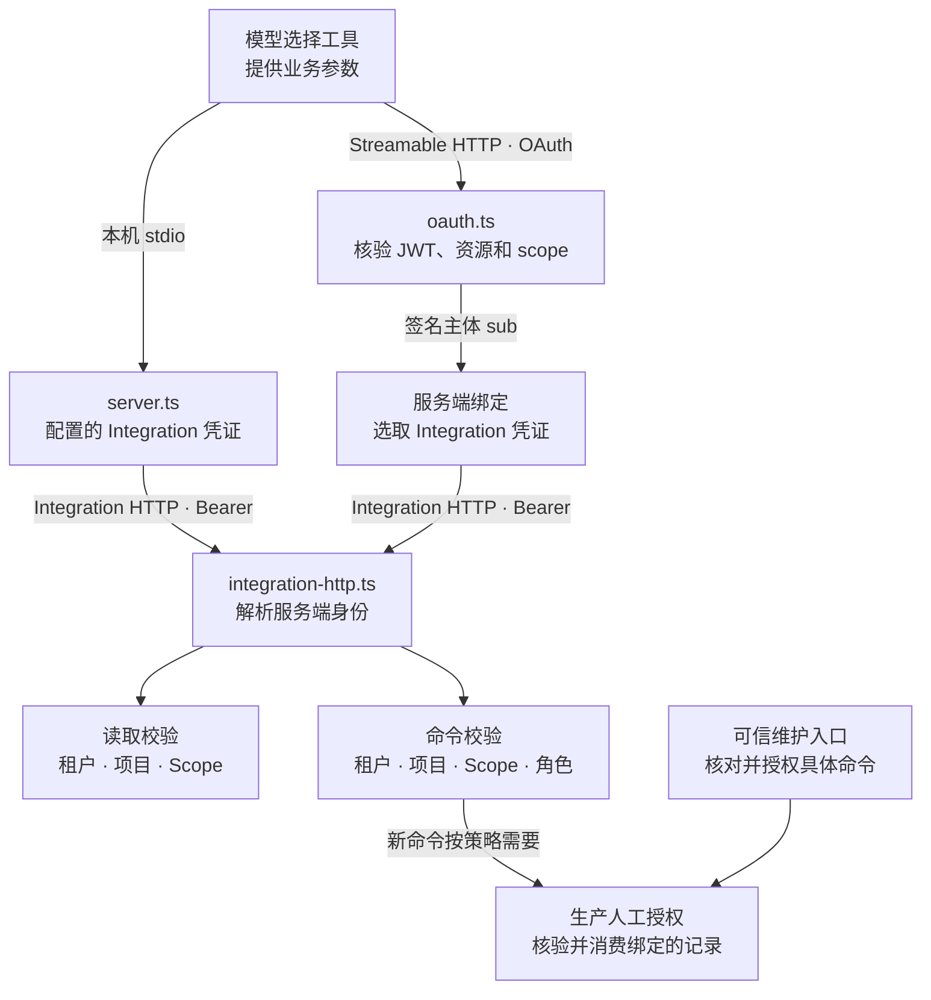
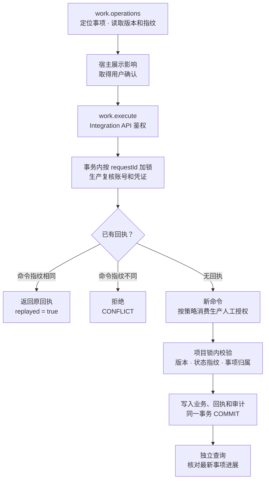

# 系统架构总览

这份文档回答三个问题：系统由哪些部分组成、一次写操作真正走哪条路径、哪些不变量是"不能破"的。
所有事实都能在代码里找到对应位置；最后一节列出当前的架构债务，不做美化。

---

## 1. 它是什么

鼎江智绩是一个**顾问交付系统**：把"订单延期"这类模糊问题，变成有证据、有阶段门、有人签字确认的交付项目。

它的立身之本是三句话，也是所有架构决策的源头：

1. **PostgreSQL 是唯一业务事实源**。任何 UI 缓存、模型输出、消息队列都不是事实。
2. **AI 产出永远是提案**（`PROPOSAL`），不写入事实；写入必须由人或有确定性规则的命令完成。
3. **每条事实都必须能追到证据**，证据定位到不可变的 `SourceVersion`。

---

## 2. 分层视图

[系统与业务总览](../../README.md#系统与业务总览)展示宿主、两种 MCP 传输、Integration API 和 PostgreSQL 的关系。Web 角色控制台通过 HTTP 读取 API 的业务记录。飞书与 n8n 使用各自配置的 Integration 接入范围。

依赖方向由 [架构守卫](../../tooling/architecture/boundaries.test.ts)校验。共享契约从包根导出，Web 通过 API 访问数据，MCP 在适配层结束。

---

## 3. 三个入口，一套事实

| 入口                       | 调用方             | 凭证与边界                                                                           |
| -------------------------- | ------------------ | ------------------------------------------------------------------------------------ |
| `apps/web`                 | 员工、负责人、专家 | 生产浏览器会话使用 cookie，业务路由由 `ProductionAccessGuard` 限制为只读             |
| `services/dingjiang-mcp`   | Agent 宿主         | stdio 使用配置的 Integration 凭证。远程入口验证 OAuth，再使用绑定的 Integration 凭证 |
| `apps/api/src/integration` | MCP 和其他集成     | Integration Bearer 绑定项目与 Scope，业务读写在 API 层校验                           |

`work.execute` 通过 Integration API 执行受治理命令。Web 经业务 API 读回同一份事实。 [生产浏览器守卫](../../apps/api/src/identity/identity-http.ts)

`workspace.resume`、`work.context` 和 `evidence.bundle` 各通过一次 Integration HTTP 请求获取结果。API 按工具所需的 scope 校验权限，在 PostgreSQL 只读快照内复用来源任务和证据提案。

---

### 权限与信任边界



这张图说明业务身份从哪里取得，以及每一层能授予什么。OAuth 的写 scope 只决定远程宿主可用的工具面。Integration API 仍检查实际调用身份和范围。宿主确认及 `confirmation` 字段表达用户意图；生产人工授权由可信入口按身份、项目、请求、版本和命令指纹独立绑定。常规进展记录按策略可免这份独立授权，仍走命令校验。 [OAuth 绑定](../../services/dingjiang-mcp/src/oauth.ts) · [Integration 鉴权](../../apps/api/src/integration/integration-http.ts) · [人工授权策略](../../apps/api/src/command-kernel/production-authorization.ts)

## 4. 一次受治理写入的真实路径



这张图说明一次进展写入在什么顺序下提交或重放。旧回执分支仍需通过当前授权，匹配原命令指纹后直接返回已存回执。新命令才会进入人工授权、版本和状态指纹校验。拒绝时事务回滚。独立回读是另一次查询，检查的是当前业务状态。 [命令内核](../../apps/api/src/command-kernel/governed-command-kernel.ts) · [事务与回执](../../apps/api/src/command-kernel/postgres-governed-command-store.ts) · [事项写入](../../apps/api/src/integration/work-execution.service.ts)

---

## 5. 项目状态机与阶段门

项目不是一个状态字段，是**七个阶段 + 每阶段一道门**。前两个阶段随项目一同建立、随即完成——`PROJECT_SCOPING`（明确要解决的问题）与 `BASELINE_FACTS`（核清事实）——所以下面从第三个阶段画起：

```text
ROOT_CAUSE_VALIDATION   根因验证    ── 证据 + 工作底稿，员工确认
        │ gate: OPEN → APPROVED
        ▼
SOLUTION_APPROVAL       方案定稿    ── PMC 提交，OWNER 批
        │ gate: PENDING → APPROVED / RETURNED
        ▼
EXECUTION_CONTROL       执行控制    ── 子任务逐个推进，每次写记事件
        │ gate: OPEN → APPROVED
        ▼
RESULT_ACCEPTANCE       结果验收    ── 指标对比，员工确认结果
        │ gate: OPEN → APPROVED
        ▼
KNOWLEDGE_CAPTURE       经验沉淀    ── 经验候选 → 专家审核 → 正式经验
```

门的四种状态各有硬语义，落在 `vs01_project_phases.gate_status`：`LOCKED`（前一阶段没过，改不动）、`OPEN`（可操作）、`PENDING`（已提交待裁决）、`RETURNED`（被退回，带理由）。

**阶段推进是代码算出来的，不是配置出来的**：`updateSubtask` 在每次状态变更后重新统计"本阶段应完成数与已确认数"，只有 `confirmed_at` 与 `confirmed_by` 都非空才算真完成。这样"点了完成"和"确认完成"不会混为一谈。

---

## 6. AI 在哪、不在哪

| 位置                              | 做什么                                                     | 不做什么                       |
| --------------------------------- | ---------------------------------------------------------- | ------------------------------ |
| `assistant`（VS12）               | 观察已提交事件，读授权快照，产出可追溯提案，SSE 推给侧边栏 | 不执行任何业务命令；不进入事务 |
| `experience-intelligence`（VS17） | 经验抽取、检索、复盘建议                                   | 不发布经验，发布要专家签字     |
| `task-orchestration`（VS18）      | 生成任务提案、金额建议                                     | 提案进审批请求，人批了才落地   |
| `workpapers`（VS16）              | 根因底稿草稿                                               | 底稿结论要员工逐条确认         |

一条工程约束把这条边界钉住了：AI 相关的表（`vs12_*`、`vs17_*`、`vs18_*`）里没有任何一列能让业务状态前进。模型挂了、超时了、说胡话了，业务事实不受影响——因为业务事务在提交时才写 `vs12_work_events` 的 outbox，之后 AI 链路失败只会影响通知，不会回滚事实。

---

## 7. 契约层为什么独立成包

`packages/contracts` 是纯 Zod schema，被 API、Web、MCP 三方共同依赖：

- **API** 用它校验入参、定义回执形状；
- **Web** 用它 `schema.parse()` 响应——契约漂移会在数据层炸，而不是在白屏里炸；
- **MCP** 用 `z.toJSONSchema(schema, { io: "output" })` 派生出 28 个 `outputSchema`，让宿主知道工具返回什么。

一份定义、三个消费者、零重复。tier5 前端 e2e 能成立的全部前提就是这一条。

---

## 8. 已知的架构债务（不美化）

### 8.1 `apps/api/src/vs01.service.ts`：416 行、一个门面

它曾经是全仓库最大的单点问题：5261 行、94 个方法、六个上下文混在一个类里。现在它是一层门面——保留所有对外方法签名，把实现交给六个各自负责的服务：

| 模块          | 负责                 | 关键方法                                         |
| ------------- | -------------------- | ------------------------------------------------ |
| `read-model/` | 只读投影             | `employee` `boss` `task` `project` `findProject` |
| `materials/`  | 材料登记、导入、撤回 | `importTaskMaterial` `materialById`              |
| `projects/`   | 项目状态机           | `createProject` `updateSubtask` `taskTemplates`  |
| `experience/` | 经验资产生命周期     | `approveExperienceCandidate` `retractExperience` |
| `assistant/`  | AI 引导与反馈        | `assistProject` `createAssistantFeedback`        |
| `tasks/`      | 任务决策与回退       | `decideTask` `revertTaskDecision`                |

项目来源、材料和证据的窄查询直接复用门面持有的读模型实例。只读快照使用绑定到同一 PostgreSQL 连接的读模型。

搬移的顺序是按耦合度从低到高，每一步都以全量用例做回归护栏：

1. **AI 引导分析**（八个纯函数）→ `assistant/guided-analysis.ts`。零事务、零状态写入，是耦合度最低的一块。
2. **材料子域** → `materials/material-service.ts`，投影拆到 `material-projection.ts` 由读写两侧共享。
3. **读模型** → `read-model/read-model-service.ts`。只读的部分原本是一张网——`projects()` 调 `project()`，`project()` 调 `findProject()`——所以整张网一起搬。
4. **项目状态机** → `projects/project-lifecycle-service.ts`。
5. **经验资产** → `experience/experience-service.ts`。因为上一轮已把共享写原语抽走，这一步最省力。
6. **AI 助手与任务决策** → `assistant/assistant-service.ts`、`tasks/task-decision-service.ts`。

**每一次搬移都要守的东西是事务纪律。** 绑定实例跑在命令内核的事务内，绝不 commit / rollback / release 调用方的 client；独立实例自己开自己关。命令都以"写完再读回"结束，那次读必须走同一个事务，否则返回的是数据库还没提交的状态——所以读模型是各写入服务的协作者，不是便利工具。

三方共享的写原语（追加项目事件、锁定项目节点、校验操作者）抽到 `projects/project-primitives.ts`；七个阶段的名字、目的与模板抽到 `work-stages.ts`；两个跨读写共用的投影抽到 `read-model/projections.ts`。都是普通函数或常量，两侧共同 import，不复制。

两处纯构造随后也各归其位，**判据是方法体零 `this` 引用**，因此是整体搬移而非改写：503 行的任务模板表从项目状态机移到 `projects/task-templates.ts`，类内只留同名薄委托以保住既有调用与测试；读模型的任务情景目录、证据记录、候选视图与输入要求映射移到 `read-model/projections.ts`，调用点改为 import 同名函数（`evidence` 因与局部变量重名而用 `buildEvidence` 别名）。状态机 1812 → 1304 行，读模型 1144 → 959 行，公共方法签名与返回类型不变。

同时删掉了 `projectTransition`（生产零调用、只有测试在测的死代码）以及 `date` / `delay` 两个只是 `isoDate` / `delayDays` 的薄包装。

`tooling/architecture/boundaries.test.ts` 的尺寸棘轮守着这个文件不许再长大，预算随每次拆分同步下调（5261 → 4888 → 4642 → 3560 → 1779 → 423 → 416）。`tooling/architecture/facade.test.ts` 另外盯着方法体：除启动检查外，门面方法只能委托给六个服务，不得直接执行 SQL 或就地写领域逻辑；`documentation.test.ts` 则把这里的行数与代码、棘轮预算三者钉在一起。

### 8.2 其他已记录的债务

- **迁移校验和不可回改**：已发布的迁移一旦发布，任何字符改动都会导致启动失败。这是刻意的（防静默改历史），代价是修正只能新增迁移。
- **迁移文件被重写会让本地活库与新部署分叉**：本仓库历史上有两个迁移文件被重写过（旧的 ERP 拉取与 WPS 投影），长期使用的本地库因此多出五张代码零引用的表，而全新部署不会有——两边结构悄悄分开了。现在 `migrate` 会检查 `schema_migrations` 里是否存在仓库中已不存在的迁移并拒绝启动，`pnpm --filter @dingjiang/api db:reset` 改为重建 schema 而不是只清数据，用来修复这类漂移。
- **重建 schema 会丢掉默认权限**：`CREATE SCHEMA public` 不等于 PostgreSQL 初始化时那个 public schema——后者带 `GRANT USAGE ... TO PUBLIC`，重建的那个不带。少了这条，运行时角色看不见任何表，报出来的是"relation does not exist"，而不是本该报的权限错误，排查方向会被完全带偏。`db:reset` 现在会显式补回这条授权并把 schema 的 owner 交回 `pg_database_owner`。
- **`~/.workbuddy/mcp.json` 里 `DINGJIANG_MCP_API_TOKEN` 是明文**：本机配置文件，不在仓库内，但仍是待处理项。
- **没有浏览器级 e2e**：判据取舍见 `README.md` tier5 一节。当前用数据层直驱覆盖契约，不覆盖渲染。

---

## 9. 验证这一切的方式

架构不是靠文档保证的，是靠下面这些可执行的门：

| 门         | 位置                                                 | 挡住什么                               |
| ---------- | ---------------------------------------------------- | -------------------------------------- |
| 依赖方向   | `tooling/architecture/boundaries.test.ts`            | 领域层偷偷依赖框架、Web 偷偷连数据库   |
| 契约       | `packages/contracts/*.test.ts`                       | 三方对同一形状理解不一致               |
| 工具元数据 | `services/dingjiang-mcp/src/tool-contract.test.ts`   | 只读工具被标成可写、写工具漏了幂等信封 |
| 数据库行为 | 五层 `pnpm test:integration`（238 用例）             | 状态机、幂等、越权、RLS                |
| 读路径索引 | `apps/api/src/read-path-indexes.integration.test.ts` | 热查询悄悄退回全表扫描                 |
| 真实进程   | tier4 / tier5                                        | 打包产物、启动、鉴权、stdio 帧一起坏   |

`main` 分支已把 `verify` 与 `integration` 设为必需检查：以上任何一条不过，合不进去。
