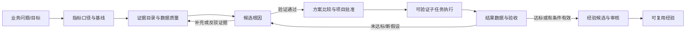

# 企业绩效咨询师工作流程研究笔记

> 目的：为“鼎江智绩 2.0”把咨询项目建模为员工可实际执行、可审计、可复盘的工作流，而不是把“项目进度”简化为一个百分比。本笔记只把权威框架转换为产品建模建议；具体客户的目标值、证据标准与方案仍需由项目发起人确认。

## 1. 研究结论

绩效咨询不是“接到问题后给建议”或“安排培训”。ATD 将其描述为：以结果为导向的系统过程，识别绩效问题、分析根因、选择和设计行动、在工作场所管理解决方案、测量结果并持续改进。[ATD HPI 术语表](https://careerpathways.td.org/glossary)；ATD 也明确把培训视为可能选项之一，而非绩效问题的默认答案。[ATD Master Performance Consultant](https://www.td.org/education-courses/atd-master-performance-consultant-program)

因此，系统的最小闭环应是：

```text
业务结果异常 → 界定目标与基线 → 证据取证与根因验证 → 选择并批准干预方案
→ 按任务执行与变更管理 → 测量结果/决定继续或调整 → 固化可复用经验
```

这不是单向流水线：每个“决策门”都可以退回补充证据、重新分析或调整方案。ISO 对过程方法的表述支持这种建模：相互关联的活动应作为连贯系统被理解和管理，过程应被分析、监测、测量和改进，并采用 PDCA 与基于风险的思维。[ISO/IAF《Guidance on Processes》](https://committee.iso.org/files/live/sites/tc176/files/documents/ISO%209001%20Auditing%20Practices%20Group%20docs/Auditing%20to%20ISO%209001%202015/APG-Processes2015.pdf)

## 2. 建议的项目节点：每个节点都是一个“人能完成的工作包”

下表是对 ATD HPI、ISO PDCA、APQC 流程层级和 Balanced Scorecard Institute（BSI）策略执行方法的综合建模，并非任何一家机构的逐字项目模板。

| 节点                    | 输入（员工拿到什么）                            | 处理（员工实际做什么）                                                                                           | 输出（留下什么可复查的东西）                                           | 决策门 / 退回条件                                                                     |
| ----------------------- | ----------------------------------------------- | ---------------------------------------------------------------------------------------------------------------- | ---------------------------------------------------------------------- | ------------------------------------------------------------------------------------- |
| 0. 项目立项与问题界定   | 业务触发、客户诉求、初步指标、项目发起人        | 明确业务结果、范围、角色、约束；把模糊抱怨改写为可观察的绩效差距                                                 | 项目章程；问题陈述；范围内/外；初始 RACI；目标指标草案                 | 发起人确认“值得投入且在本项目范围内”；否则关闭或转交日常运营                          |
| 1. 基线与事实核对       | 指标定义、数据源、历史数据、业务流程、访谈对象  | 核对口径、时间窗、数据质量；计算当前值/目标值/差距；绘制当前流程和异常分布                                       | 证据目录；指标口径；基线快照；事实清单；数据缺口清单                   | 证据足以描述差距才进入诊断；数据冲突/缺失则补数，不得先下结论                         |
| 2. 根因诊断与验证       | 基线、证据、现场观察、访谈、流程图、假设清单    | 区分事实、假设、推断；提出候选原因；检查流程、资源、规则、技能、信息、激励和协同等条件；用新增证据验证或否决假设 | 根因树；每项原因的证据链接、置信状态与影响说明；已否决假设             | 客户与项目负责人确认“主要原因已被充分验证”；证据不足则回到节点 1                      |
| 3. 方案共创、选择与批准 | 已验证根因、约束、资源、风险、经验案例          | 为每个根因设计多个干预组合；评估预期影响、成本、风险、负责人和可测性；形成实施任务包                             | 方案比较；被选方案；行动项目章程；子任务分解；验收指标；风险与沟通计划 | 有权人批准范围、预算、负责人、目标和验收方式；退回时记录修改原因                      |
| 4. 执行改善与过程控制   | 已批准方案、子任务、责任人、所需材料、计划日期  | 完成可验证的小任务；登记产出与依据；处理阻塞；进行变更沟通、辅导和协同；按事实自动汇总节点进度                   | 子任务完成记录；材料/证据引用；阻塞与风险；变更记录；过程指标          | 任务完成不等于项目成功；发现假设不成立、风险失控或范围变化时，回到节点 2 或 3         |
| 5. 结果验证与项目结项   | 执行记录、结果数据、新基线、验收口径            | 按事先约定的口径比较 before/current/target；识别副作用和归因边界；决定达标、部分达标、未达标或继续观察           | 结果验证报告；验收结论；剩余风险；是否推广/继续改善的建议              | 业务负责人签收结果；未达标则进入调整方案或新的诊断循环，不能用“任务 100%”替代效果验收 |
| 6. 经验沉淀与复用       | 全部项目档案、有效/无效做法、适用条件、结果证据 | 提炼“在何种情境、对什么问题、采取什么做法、得到什么证据结果”；审核去敏与适用范围；发布后跟踪复用反馈             | 候选经验；审核状态；适用条件；证据链接；复用记录；版本历史             | 经责任人审核才成为正式经验；证据不足只保留为“待验证做法”，不得作为确定性规则          |

### 节点为何要拆成小任务

APQC 的 PCF 是按层级把工作分解到任务层的过程分类方法；其目的包括建立共同语言、比较绩效、组织流程与知识。它强调描述“组织做什么”，而不是照搬组织架构。[APQC PCF FAQ](https://www.apqc.org/process-frameworks/pcf-faqs)；[APQC PCF 介绍](https://www.apqc.org/GettingStartedWithTheAPQCProcessClassificationFramework%C2%AE)。

对系统而言，这意味着：**节点是可管理的工作包，子任务才是员工可完成的最小事实**。节点进度应由 `已完成且有完成依据的子任务数 / 子任务总数` 推导；节点完成更不等于业务结果达标。APQC 也将流程定义与关键度量关联，用于测量、跟踪和基准比较。[APQC PCF 8.0 定义与关键度量](https://www.apqc.org/resource-library/resource-collection/pcf-version-80-process-definitions-and-key-measures-collection)

## 3. 节点内的小任务模板

系统不应要求员工“写一段进度说明”就推进节点。每个小任务至少包含：

| 字段            | 含义                                                                           |
| --------------- | ------------------------------------------------------------------------------ |
| 任务名称与目的  | 明确要交付的工作事实，例如“核对 OTD 指标口径”，不是“处理一下数据”              |
| 输入材料        | 需要的报表、原始单据、访谈纪要、流程版本或系统链接；每份标明已具备/缺失/待核验 |
| 操作步骤        | 可执行清单；允许按不同情境加载不同材料和方法                                   |
| 责任人 / 协作人 | 谁实际完成，谁提供材料，谁有决策权                                             |
| 完成依据        | 文件、记录、指标快照、会议纪要或证据引用；没有依据不能自动完成                 |
| 输出物          | 结构化结论、决策草案、任务包、风险项或验证报告                                 |
| 质量检查        | 口径一致、证据可追溯、范围符合、责任人明确等                                   |
| 回滚 / 重开     | 误点或发现证据失效时，需说明原因，保留原记录和审计历史                         |

### 以“订单准时交付率下降”举例

**节点 1：基线与事实核对**

- 输入：订单、承诺交期、计划/实际 BOM 完成日期、采购到货日期、排产和完工日期；以及 OTD 指标口径。
- 子任务：确认计算口径；抽样核对原始单据；计算 30/90 天基线；按产品/客户/工序切片；登记缺失字段。
- 输出：经确认的 OTD 基线、延期订单清单、数据质量问题、证据引用。

**节点 2：根因诊断与验证**

- 输入：已确认的延期订单、异常切片、BOM/采购/产能相关证据、现场/访谈记录。
- 子任务：列出候选原因；为“BOM 准备滞后”“关键物料到货延迟”“产能负荷超阈值”分别关联证据；记录反证；确认主要原因和影响链。
- 输出：已验证原因、未证实原因、每条结论的证据和后续行动建议。

**节点 3：方案选择与批准**

- 输入：已验证根因、可用资源、预计影响、风险、客户约束。
- 子任务：列可选方案；评估影响/成本/风险；确定责任人与截止日；拆出执行子任务；提交批准。
- 输出：已批准的改善项目和不可覆盖的批准/退回记录。

**节点 4：执行改善**

- 输入：已批准任务包、负责人、材料、截止日期。
- 子任务示例：完成 BOM 问题分类；补齐缺失 BOM；发布治理清单；召开责任人评审；验证规则已被使用。每一项必须有完成依据。
- 输出：自动派生的进度、阻塞项、过程指标和变更记录。

**节点 5：结果验证**

- 输入：项目开始前基线、相同口径的当前数据、目标值、执行与环境变化记录。
- 子任务：重新计算 OTD；检查样本/口径一致；比较基线/当前/目标；识别副作用；形成验收建议。
- 输出：达成、部分达成、未达成或继续观察的结论及证据。

## 4. 顾问与客户的角色边界

ATD 将绩效咨询的核心工作概括为理解问题、分析可用数据、呈现发现、开发并实施方案；其角色包括分析者、干预方案专家、变革管理者和评估者。[ATD Master Performance Consultant](https://www.td.org/education-courses/atd-master-performance-consultant-program)；[ATD《4 Key Roles of Performance Consultants》](https://www.td.org/content/newsletter/4-key-roles-of-performance-consultants)。

落到系统应明确区分：

| 角色                    | 对工作流负责                                                           | 不应由其单独决定                                           |
| ----------------------- | ---------------------------------------------------------------------- | ---------------------------------------------------------- |
| 企业发起人 / 业务负责人 | 业务优先级、结果目标、资源和最终验收；批准或退回关键决策               | 伪造数据、绕过证据要求，或把咨询意见当成自动执行命令       |
| 一线责任人 / 项目成员   | 提供现场事实和材料；执行被批准的子任务；报告阻塞；确认实际可行性       | 在无授权情况下改变目标、预算、范围或验收口径               |
| 绩效咨询师              | 设计诊断、把事实与假设分开、促成根因验证、比较方案、建立度量和复盘机制 | 替客户拥有业务结果；越过客户的资源/优先级决策权            |
| 系统 / AI 助手          | 汇总证据、提示缺失材料、生成候选假设与方案草稿、追踪任务和审计         | 把推断呈现为事实，替人批准、替人确认根因或替人宣告项目成功 |

BSI 的公开材料也将指标、目标和行动项目区分开：KPI 为战略目标及结果提供客观进展证据，而战略行动项目是为弥合目标差距而选择的项目；该框架还要求在实施后收集、报告、分析绩效信息并据实际表现修订策略。[BSI《Creating and Executing Winning Strategies》](https://balancedscorecard.org/wp-content/uploads/2023/06/Creating-and-Executing-Winning-Strategies-9-Step-Framework_Handouts.pdf)；[BSI《Nine Steps to Success》](https://balancedscorecard.org/wp-content/uploads/2022/09/Essentials-Overview-Webinar-Final.pdf)。这支持“老板审批项目与验收结果、员工完成任务、系统呈现证据”的边界，而不是让单一用户既下结论又自动批准。

## 5. 证据、基线、根因、方案、执行、结果与经验的关系



ISO 指出，基于数据与信息的分析和评价作出的决策更可能产生期望结果；同时应理解因果关系与潜在非预期后果。[ISO《Quality management principles》，QMP 6](https://www.iso.org/iso/pub100080.pdf)。所以系统至少要让每个关键判断指向：

1. **事实 / 证据**：谁在何时从哪个来源得到，能否回看原始上下文；
2. **推断 / 假设**：尚未证实的解释，不应冒充根因；
3. **人工决策**：谁在什么依据下选择、批准、退回或撤销；
4. **执行事实**：哪个子任务被谁完成，完成依据是什么；
5. **结果证据**：与基线同口径的结果变化及副作用；
6. **经验的适用条件**：不是“永远有效的答案”，而是带行业/场景/前提/证据强度的可复用做法。

## 6. 对鼎江智绩 2.0 的直接建模建议

1. **把“经营问题”与“改善项目”分开。** 问题容器持有指标、基线、证据和根因；项目容器持有被批准的方案、子任务、资源和变更。一个问题可被多个方案处理，一个项目也可能验证后无效。
2. **让每个节点有输入、动作、输出、决策门四栏。** 没有输入材料与完成依据的任务不能成为“完成”。
3. **进度与效果必须分开显示。** `子任务完成率` 表示实施进度；`目标达成度` 表示业务结果；两者都不等于“根因已验证”。
4. **将 AI 放在候选与检查位。** AI 可以提示缺什么材料、汇总矛盾证据、生成原因/方案草稿；输出默认标为“建议/待人工确认”，不得自动跨越决策门。
5. **将经验沉淀做成结项后的审核流。** 候选经验需包含情境、问题、做法、结果、证据、限制与审批状态；避免把一次偶然有效的做法写成企业规则。
6. **把回退设计为工作的一部分。** 判断、批准和完成应保留原历史并允许“重开/退回/修订”，下游已依赖时转为显式影响评估，不做静默覆盖。

## 7. 来源说明

- [ATD Career Pathways Glossary](https://careerpathways.td.org/glossary)：HPI、绩效咨询、绩效分析、绩效差距的官方术语定义。
- [ATD Master Performance Consultant Program](https://www.td.org/education-courses/atd-master-performance-consultant-program)：ATD 对绩效顾问系统性根因分析、方案推荐与实施，以及真实咨询任务范围的说明。
- [APQC Process Classification Framework FAQ](https://www.apqc.org/process-frameworks/pcf-faqs) 与 [PCF 8.0 定义和关键度量](https://www.apqc.org/resource-library/resource-collection/pcf-version-80-process-definitions-and-key-measures-collection)：流程/任务层级、共同语言、度量和基准的权威资料。
- [ISO/IAF Guidance on Processes](https://committee.iso.org/files/live/sites/tc176/files/documents/ISO%209001%20Auditing%20Practices%20Group%20docs/Auditing%20to%20ISO%209001%202015/APG-Processes2015.pdf) 与 [ISO Quality Management Principles](https://www.iso.org/iso/pub100080.pdf)：过程方法、PDCA、监测测量与循证决策。
- [Balanced Scorecard Institute Nine Steps to Success](https://balancedscorecard.org/wp-content/uploads/2022/09/Essentials-Overview-Webinar-Final.pdf) 与 [Creating and Executing Winning Strategies](https://balancedscorecard.org/wp-content/uploads/2023/06/Creating-and-Executing-Winning-Strategies-9-Step-Framework_Handouts.pdf)：从指标、目标到行动项目、执行、分析和评估的公开框架。
