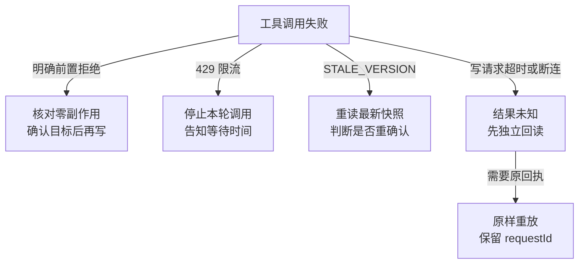

# MCP 协议与接入

使用与配置见 [README.md](README.md)。

[系统与业务总览](../../README.md#系统与业务总览)展示 stdio、Streamable HTTP 和 Integration API 的连接关系。业务授权见 [权限与信任边界](../../docs/architecture/system-overview.md#权限与信任边界)。

## 1. 版本与传输

| 版本         | 发现和调用                                               |
| ------------ | -------------------------------------------------------- |
| `2025-06-18` | `initialize` 握手，然后调用 `tools/list` 与 `tools/call` |
| `2026-07-28` | 可先调用 `server/discover`，每个请求携带版本与能力       |

同一 stdio 入口沿用有界队列与按序响应。两个版本共享工具注册和业务分发。远程入口用官方 TypeScript SDK v2 处理 HTTP 传输与协议校验。 [MCP 版本兼容规范](https://modelcontextprotocol.io/specification/2026-07-28/basic/versioning) · [TypeScript SDK v2](https://ts.sdk.modelcontextprotocol.io/v2/protocol-versions)

### Streamable HTTP 与 OAuth

`server-http.ts` 将单个 `/mcp` 端点接到 SDK 的逐请求处理器。入口校验公开地址对应的 Host 和 Origin，再验证 OAuth Bearer。SDK 按请求校验 HTTP 头与 JSON-RPC 元数据。常规工具请求返回 JSON，每个请求独立处理。

HTTP 入口发布 RFC 9728 资源元数据，`oauth.ts` 生成授权挑战并验证访问令牌。验证通过后，HTTP 处理器按签名后的主体选取 Integration 令牌，用它调用业务 API。OAuth 的读写范围限定本次工具面，API 再检查角色、项目、版本、幂等和审计规则。 [Streamable HTTP](https://modelcontextprotocol.io/specification/2026-07-28/basic/transports/streamable-http) · [OAuth 授权规范](https://modelcontextprotocol.io/specification/2026-07-28/basic/authorization)

## 2. stdio 会话的完整往返

1. 启动时固定工具面、只读策略和构建标识。旧版通过 `initialize` 握手，新版可用 `server/discover`，并在每次调用携带 `_meta`。
2. `tools/list` 返回当前会话的有序工具面。常规面为 13 或 23 个工具，只读面为 7 或 17 个工具。
3. `tools/call` 通过信封、工具面与入参检查后，经配置的 Integration Bearer 发出 HTTP 请求。API 应用权限和业务规则，MCP 校验返回契约并交付结果。

## 3. 协议方法

### `initialize`（2025-06-18）

握手回包包含协议版本、服务端信息、工具能力和治理说明。

```json
{
  "protocolVersion": "2025-06-18",
  "capabilities": { "tools": { "listChanged": false } },
  "serverInfo": {
    "name": "dingjiang-mcp",
    "version": "0.7.0",
    "buildIdentity": "…"
  },
  "instructions": "…"
}
```

- `capabilities` 声明 tools 和 `listChanged: false`。工具面随进程启动配置固定。
- `buildIdentity` 是进程启动时记下的构建标记。每次请求都会比对当前部署，变了就返回 `SESSION_MCP_PROCESS_STALE` 并建议新建会话——否则宿主会拿着旧进程的工具清单继续调用一个已经换过的服务端。
- `instructions` 向宿主说明 `PROPOSAL` 与业务事实的边界。常规模式给出写前确认和重试规则，只读模式提示宿主引用工具返回的来源定位。
- 重复 `initialize` 返回同一份协议版本和能力声明。

### `server/discover`（2026-07-28）

客户端可先调用 `server/discover` 读取 `supportedVersions`、工具能力和治理说明，也可以直接发 `tools/list` 或 `tools/call`。每个新版请求都需在 `params._meta` 中提供 `io.modelcontextprotocol/protocolVersion` 和 `io.modelcontextprotocol/clientCapabilities`。客户端身份元数据用于描述调用方，业务授权由 Integration API 按 Bearer 令牌判断。

新版结果包含 `resultType: "complete"` 和 `_meta["io.modelcontextprotocol/serverInfo"]`。发现和工具清单以 `ttlMs: 0`、`cacheScope: "private"` 返回，宿主每次从当前进程读取实际开放的工具面。

### `tools/list`

返回的顺序是声明顺序，不是字典遍历顺序。规范建议确定性顺序，宿主才能跨轮复用工具块、命中提示词缓存。

工具不是运行时拼的：`toolRegistry` 里每个工具只有一份定义，`business` 与 `compatibility` 是两个有序名单，映射到同一批 `ToolDescriptor` 实例。共享工具在两个面里是同一个对象，改一处不会只改到一面。

`tool-contract.test.ts` 双向比对工具声明和实际处理器的名称，并通过 `tools/call` 逐个验证可达性。

### `tools/call`

`tools/call` 按以下顺序处理。

1. JSON-RPC 层校验请求信封，并按新版规则检查 `_meta`。工具名和业务参数分别来自 `name` 与 `arguments`。
2. 检查当前进程的只读策略，再按名称分发。只读模式拦截的写工具与未注册的名称均返回 `-32602` 和 `UNKNOWN_TOOL`。
3. 处理器用严格的 Zod 契约校验 `arguments`，拒绝未知字段。权限与项目范围来自服务端按令牌绑定的身份。

成功回包同时给 `content` 和 `structuredContent`，供宿主显示文本或校验、处理结构化结果。

### `ping` 与通知

`ping` 是旧版的探活方法，返回空对象。两种协议的 `notifications/cancelled` 都按 `params.requestId` 找到尚未回包的只读请求。通知自身无需回执，其余通知由服务端忽略。

## 4. JSON-RPC 的错误面

| 场景           | 返回                                         | 说明                                                                           |
| -------------- | -------------------------------------------- | ------------------------------------------------------------------------------ |
| 非法 JSON      | `-32700`，`id: null`                         | 解析失败时无法知道请求 id，规范要求 null                                       |
| 单行超限       | `-32600` + `REQUEST_TOO_LARGE`               | 在解析前拒绝，避免为一条超大行分配内存                                         |
| 信封非法       | `-32600` + `INVALID_ENVELOPE` / `INVALID_ID` | 非对象、id 非标量、`jsonrpc` 不是 `"2.0"`、`method` 非字符串——在分发前拒绝     |
| 未知方法       | `-32601`                                     |                                                                                |
| 参数不是对象   | `-32602` + `INVALID_PARAMS`                  | `params` 只能是对象或省略                                                      |
| 新版元数据非法 | `-32602` + `INVALID_PROTOCOL_META`           | 逐请求版本与能力字段需有效                                                     |
| 新版版本不支持 | `-32022`                                     | `data` 返回 `requested` 与 `supported`                                         |
| 工具入参非法   | `isError: true` + `INVALID_REQUEST`          | 已找到工具，入参未通过该工具的 Zod 契约                                        |
| 未知工具名     | `-32602` + `UNKNOWN_TOOL`                    | 与「工具执行失败」分开：后者是结果里的 `isError`，前者是这个请求根本不该被分发 |
| handler 抛异常 | `-32603` + `HANDLER_FAILURE`                 | 诊断写 stderr，不进协议流，也不中断后续请求                                    |

业务失败通过 `isError: true` 和文本 JSON 交付 `code`、`retryable`、`requiresHuman` 及可用的追踪号。限流可附 `retryAfterSeconds`。成功结果同时携带契约匹配的 `structuredContent` 和 `content`。

| 类型                        | 含义                              | 是否保留原文             |
| --------------------------- | --------------------------------- | ------------------------ |
| `IntegrationClientError`    | 服务端返回的标准 failure envelope | 保留（服务端消息可信）   |
| `IntegrationTransportError` | 超时 / 网络 / 响应与契约不一致    | 保留（我们自己写的文案） |
| `ZodError`                  | 入参不符合契约                    | 固定文案                 |
| 其它异常                    | 未预期                            | **不保留**，只给固定文案 |

最后一行是刻意的：任意异常的 message 可能带出文件路径或内部标识，直接回给宿主等于把它们写进对话记录。

### 错误与恢复



这张图说明宿主收到失败信息后如何判断下一步。已提交的响应可能丢失。独立查询能确认当前进展，只有匹配的原回执能确认某个 `requestId` 的提交结果。明确前置拒绝且确认零副作用后，可以形成新命令。限流和版本冲突由宿主提示用户，等待时间缺失时报告未知。结果未知的写入保留原命令字段和请求编号，由宿主在有授权时发起核对或原样重放。 [错误映射](src/tools/dispatch.ts) · [网络错误与请求追踪](src/client.ts) · [幂等回执](../../apps/api/src/command-kernel/postgres-governed-command-store.ts) · [断连验收](../../apps/api/src/integration/real-e2e.integration.test.ts)

## 5. stdio 的队列与响应

`stdio.ts` 负责调度请求、限制待处理数量和写出响应。

1. 相邻的只读工具调用最多并发 4 个。结果按入队顺序发出，写 stdout 时等待 `drain`。
2. 初始化和受治理写入等串行请求等待前面的响应发出，后续读在串行请求完成后启动。
3. 取消通知绕过队列。排队的读会跳过执行，运行中的读通过 `AbortSignal` 中止 HTTP 请求，尚未发出的读响应会丢弃。受治理写入继续执行并返回原回执。
4. 队列默认接受 64 个未完成请求，包含等待发出的响应。额满时立即返回 `QUEUE_OVERFLOW`。单行长度在 JSON 解析前检查。
5. handler 异常转换为 `HANDLER_FAILURE`，诊断写入 stderr。

stdio 用于受信任的本机宿主。`readline` 会在收到完整行后交给调度器做字节检查，尚未换行的数据由 Node.js 缓冲。远程客户端使用带请求体限制的 Streamable HTTP 入口。

## 6. 元数据不是抄出来的

- `annotations` 覆盖全部工具，`readOnlyHint` 与「入参是否同时必填 `requestId` + `expectedVersion`」双向断言——受治理写不可能被标成只读。
- 28 个工具均声明 `outputSchema`。三个聚合工具按发布的 Zod 契约裁剪结果，对包含 `structuredContent`、`content.text` 和新版协议元数据的完整 `result` 设 512 KiB 上限。超限以 `isError: true` 和文本 JSON 返回错误码。各工具保留的字段见 [工具说明](README.md)。
- `project.next_action` 由业务 API 派生。MCP client 按共享契约校验响应，该契约要求 `classification` 为 `PROPOSAL`。

## 7. 故意不做

| 不做                              | 理由                                                                                                      |
| --------------------------------- | --------------------------------------------------------------------------------------------------------- |
| 协议版本表（曾支持 `2025-03-26`） | 没有真实客户端使用；一条没人走的兼容分支会让「会话承诺了什么」难以核对                                    |
| `resources` / `prompts`           | 当前没有宿主消费它们；只声明不实现比不声明更糟                                                            |
| `progress` 通知                   | 聚合工具最长也就数秒，进度条收益低于实现与测试成本                                                        |
| `tools/list` 分页                 | 28 个工具远没到需要游标的量级                                                                             |
| 压缩 inputSchema                  | 6 个写工具共享同一套 governed envelope，重复是必然；用 `$ref` 省几 KB，赌所有客户端正确解析跨 schema 引用 |

## 8. 怎么证明它是对的

协议实现最怕"看起来对"。这里的做法是让每条不变量都有可执行的证据：

- `evals/` 的 46 个用例直接驱动 `dist/` 里的真实 dispatcher，覆盖 happy path、越权注入、参数守卫、超时恢复、缺失降级与协议契约。
- 两种协议与两套工具面组成四组矩阵，每组跑同一套 40 个契约用例。
- 真实端到端测试同时启动旧版和新版 stdio MCP，新版写入后用旧版重放并回读同一条回执。
- 远程端到端测试用本地 OAuth 发行方完成授权码与 PKCE，再经实际 MCP HTTP、Integration API 和 PostgreSQL 验证只读拦截、授权写入和回读。
- `tool-contract.test.ts` 双向比对声明与实现，并检查 `annotations` 与入参契约是否一致。
- 变异验证：删掉错误脱敏、忽略宿主档案、让视图返回副本而不共享实例——每一次都应有测试变红；没有变红的守卫等于没有守卫。

## 9. 读代码的顺序

1. `endpoint-policy.ts`（67 行）：允许连哪个 API，为什么。
2. `client.ts`（386 行）：三类错误的边界，响应如何按契约校验。
3. `tools/schemas.ts` 和 `tools/catalog.ts` 定义工具的入参、输出、治理标注和有序清单。
4. `tools/dispatch.ts` 按域执行工具，组装聚合结果并映射工具错误。
5. `stdio.ts` 负责有界队列、请求解析与 stdout 背压。
6. `protocol.ts` 负责会话状态、握手幂等和 JSON-RPC 错误。
